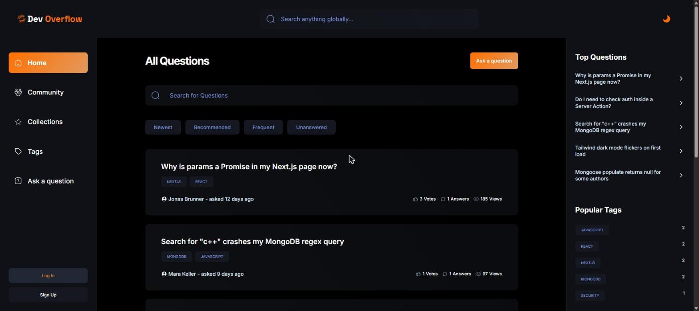
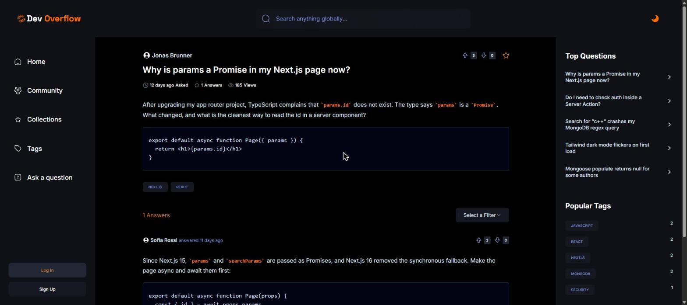

# DevOverflow

Eine Frage-Antwort-Plattform für Entwickler:innen im Stil von Stack Overflow: Fragen stellen, mit Code-Beispielen antworten, abstimmen, Fragen speichern und nach Tags oder Personen suchen.

> **Tutorial-Projekt, nachgebaut nach dem Next.js-Kurs von JS Mastery.**
> Aufbau, Design und Grundfunktionen stammen aus dem Kurs ([JS Mastery](https://jsmastery.com/)).
> Ich habe die App Schritt für Schritt nachprogrammiert, um Next.js, Server Actions, MongoDB und Authentifizierung zu lernen.

**Live-Demo:** [stack-overflow-next14-nu.vercel.app](https://stack-overflow-next14-nu.vercel.app)

Als Gast kann man alles ansehen und durchsuchen. Zum Fragen, Antworten und Abstimmen registriert man sich mit einer E-Mail-Adresse.

## Funktionen

- Fragen stellen und bearbeiten (Rich-Text-Editor mit Code-Blöcken und Syntax-Highlighting)
- Antworten schreiben, Up- und Downvotes, Fragen in einer eigenen Sammlung speichern
- Tags, Community-Seite und Profile mit Reputation und Abzeichen
- Globale Suche über Fragen, Antworten, Tags und Personen sowie Filter und Seitennavigation
- Empfehlungen anhand der Tags, mit denen man schon zu tun hatte
- Login und Registrierung mit Clerk, Hell- und Dunkelmodus
- Optional: KI-Antwortvorschlag über OpenAI (nur mit eigenem API-Key)

## Stack

| Bereich | Technik |
| --- | --- |
| Framework | Next.js 16 (App Router, Server Components, Server Actions), React 19, TypeScript |
| Daten | MongoDB Atlas mit Mongoose |
| Login | Clerk (inkl. Webhook, der neue Accounts in MongoDB anlegt) |
| UI | Tailwind CSS 3, shadcn/ui (Radix), TinyMCE, Prism.js |
| Formulare | React Hook Form mit Zod-Validierung |
| Hosting | Vercel |

## Wartung 2026

Der Kurs-Stand von 2024 (Next.js 14, Clerk v4) lief nicht mehr zuverlässig und hatte bekannte Sicherheitslücken. Gegenüber dem Kurs wurde unter anderem geändert:

- Upgrade auf Next.js 16, React 19 und Clerk Core 3 (`middleware.ts` heisst jetzt `proxy.ts`, `params` und `searchParams` sind Promises)
- Jede Server Action prüft selbst, wer eingeloggt ist und ob die Person das darf. Vorher konnte man fremde Fragen löschen oder Accounts entfernen.
- Benutzer-HTML wird vor dem Anzeigen gefiltert (Schutz vor XSS), Suchbegriffe werden für reguläre Ausdrücke maskiert
- Abstürze behoben, z.B. Fragen-Detailseite für nicht eingeloggte Besucher, Suche nach `c++`, ungültige IDs in der URL
- Platzhalter aus dem Kurs ersetzt (fest eingebaute Tags und Suchtreffer, toter "Find Jobs"-Link, KI-Knopf mit `alert`)
- Einfacheres Setup: TinyMCE ist selbst gehostet (kein API-Key), neue Accounts werden auch ohne Clerk-Webhook angelegt, und die Demo-Daten werden beim Build automatisch angelegt

Die Details mit Ursache und Lösung stehen in [docs/REPARATUR-NOTIZEN.md](docs/REPARATUR-NOTIZEN.md).

## Lokal starten

Voraussetzungen: Node.js 20.9 oder neuer, eine MongoDB-Datenbank (z.B. kostenlos bei MongoDB Atlas) und eine Clerk-App.

```bash
npm install                  # kopiert auch den TinyMCE-Editor nach public/tinymce
cp .env.example .env.local   # danach die Werte in .env.local eintragen
npm run dev                  # http://localhost:3000
```

Demo-Daten (10 Demo-Personen, 26 Fragen, 29 Antworten) in die Datenbank schreiben:

```bash
npm run seed
```

Die Inhalte stehen in `scripts/seed-data.mjs`. Das Skript löscht nur seine eigenen alten Demo-Daten und kann beliebig oft laufen. `npm run build` ruft es automatisch auf, legt die Daten aber nur neu an, wenn `SEED_VERSION` in `seed-data.mjs` erhöht wurde.

Weitere Befehle: `npm run build` (Produktions-Build), `npm run lint` (ESLint).

## Umgebungsvariablen

Alle Namen stehen mit Erklärung in [.env.example](.env.example).

| Variable | Pflicht | Woher |
| --- | --- | --- |
| `MONGODB_URI` | ja | Vercel-Integration "MongoDB Atlas" (automatisch) oder Atlas → Connect |
| `NEXT_PUBLIC_CLERK_PUBLISHABLE_KEY` | ja | Vercel-Integration "Clerk" (automatisch) oder Clerk → API Keys |
| `CLERK_SECRET_KEY` | ja | wie oben |
| `CLERK_WEBHOOK_SIGNING_SECRET` | nein | Clerk → Webhooks, überträgt Profiländerungen und Löschungen |
| `OPENAI_API_KEY` | nein | nur für den KI-Antwortvorschlag |
| `OPENAI_MODEL` | nein | Standard: `gpt-4o-mini` |

## Deployment auf Vercel

1. Repository in Vercel importieren (Framework wird automatisch erkannt).
2. Im Projekt unter *Storage* bzw. *Integrations* aus dem Marketplace **MongoDB Atlas** und **Clerk** hinzufügen (Gratis-Pläne) und mit dem Projekt verbinden. Die Keys landen dabei automatisch in den Environment Variables.
3. Neu deployen. Beim Build werden die Demo-Daten angelegt.
4. Optional: In Clerk unter *Webhooks* einen Endpoint `https://<deine-domain>/api/webhook` mit `user.created`, `user.updated` und `user.deleted` anlegen und das Signing Secret als `CLERK_WEBHOOK_SIGNING_SECRET` eintragen.

Der Editor TinyMCE ist selbst gehostet (`public/tinymce`, GPL-Lizenz mit `licenseKey="gpl"`) und braucht weder Account noch API-Key.

## Screenshots





## Credits

- Kurs und Design-Vorlage: [JS Mastery](https://jsmastery.com/)
- Icons und Bilder in `public/assets` stammen aus den Kursmaterialien
